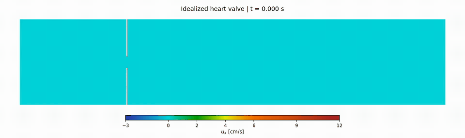

# FSI

## Heart valve simulation — ID + Neo-Hookean

[](docs/assets/heart_valve_id_neo_hookean.mp4)

[Open heart valve MP4](docs/assets/heart_valve_id_neo_hookean.mp4) · [Setup and verification](docs/idealized_heart_valve.md)

Fluid x-velocity over the complete three-second simulation, with the moving
leaflets shown in white. Playback is four times slower than physical time.

## Example

[](docs/assets/video_base_fast.mp4)

[Open MP4](docs/assets/video_base_fast.mp4)

Run the falling-square case:

```bash
python3 code/cases/run_case.py code/cases/configs/falling_square.yaml
```

Quick check without launching the simulation:

```bash
python3 code/cases/run_case.py code/cases/configs/falling_square.yaml --dry-run
```

## Local nonlinear materials (ID)

`code/immersed_fsi/nonlinear_structure.py` contains independent local copies of
the 2D SVK and Neo-Hookean laws from `structural-mechanics-fem`, adapted to FSI's
DOF ordering and reference-mesh assembly. No import or installation of that
repository is needed. Both Q1 quadrilaterals and P1 triangles are supported.

Set `case.method: id` and choose `solid.material.model: svk` or `neo_hookean`.
Existing configurations default to `linear`. The nonlinear laws use plane
strain (`plane_stress: false`) and currently require `coupling.rayleigh_beta: 0`.
The optional nonnegative `solid.material.penalty` applies only to SVK.

Run the small Neo-Hookean example:

```bash
python3 code/cases/run_case.py code/cases/configs/falling_square_neo_hookean.yaml
```

Numerical checks (rigid motion, linear limit, consistent tangents, and short
coupled ID simulations on both element types):

```bash
python3 -m unittest discover -s code/tests -v
```

## Idealized heart valve

The Black & Park section 4.3.1 case is configured with ID + Neo-Hookean,
paper geometry/BCs/CGS parameters, and shared nominal mesh spacing `h=0.02` cm
(fluid `400 x 81`, each leaflet `1 x 35` Q1 elements).

```bash
python3 code/cases/run_case.py code/cases/configs/idealized_heart_valve_id_neo_hookean.yaml --dry-run
python3 code/cases/run_case.py code/cases/configs/idealized_heart_valve_id_neo_hookean.yaml --steps 20
```

Omit `--steps 20` to run the configured three seconds. See
[setup, outlet discretization and verification](docs/idealized_heart_valve.md)
and the [geometry/mesh preview](docs/idealized_heart_valve_setup.svg).
