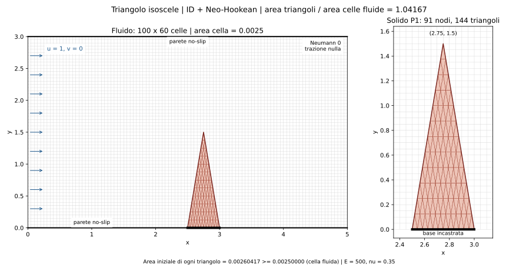

# Triangolo isoscele incastrato: setup ID + Neo-Hookean

Configurazione: `code/cases/configs/clamped_triangle_id_neo_hookean.yaml`.



- Dominio fluido: `0 <= x <= 5`, `0 <= y <= 3`.
- Triangolo esatto: vertici `(2.5, 0)`, `(3, 0)`, `(2.75, 1.5)`.
- Base incastrata: entrambi gli spostamenti nulli per i nodi su `y=0`.
- Pareti superiore e inferiore: no-slip.
- Ingresso sinistro: `u=1`, `v=0`, costanti nel tempo; fluido inizialmente fermo.
- Uscita destra: Neumann omogenea naturale, cioe' trazione totale
  `(-p*I + mu*(grad(v)+grad(v).T))*n = 0`, con il predittore corretto.
- Accoppiamento ID volumetrico; mesh fluida estesa anche nella regione solida.

I parametri sono **adimensionali**, come punto di partenza per lo studio:

| Parametro | Valore |
| --- | --- |
| Densita' fluida | 1 |
| Viscosita' dinamica fluida | 0.05 |
| Densita' solida | 1.2 |
| Modulo di Young | 500 |
| Poisson | 0.35 |
| Modello | Neo-Hookean comprimibile, deformazione piana |

Il rapporto `E/(rho_f*U^2)=500` e' un valore iniziale di rigidezza; la forma
snella e rastremata favorisce la flessione. La deformazione effettiva va
misurata in una simulazione prima di calibrare la rigidezza. Non sono aggiunti
gravita' o smorzamento strutturale.

La griglia fluida ha `100 x 60` celle (`dx=dy=0.05`), con area di ciascuna
cella pari a `0.0025`. La mesh solida impone **a ogni triangolo**, nella
configurazione di riferimento, area almeno pari a quella della cella fluida.

Nel YAML `solid.min_area_ratio: 1.0` richiede
`A_tri >= min_area_ratio * fluid_dx * fluid_dy`. Il generatore baricentrico
produce `n^2` triangoli di uguale area e sceglie il piu' grande intero
`n <= sqrt(A_solido / A_minima)`. Con area totale `0.375` si ottiene `n=12`:

| Quantita' | Valore |
| --- | --- |
| Nodi solidi | 91 |
| Triangoli solidi | 144 |
| Area di ciascun triangolo | 0.0026041667 |
| Area di ciascuna cella fluida | 0.0025 |
| Rapporto aree | 1.0416667 (triangoli maggiori del 4.17%) |

Il contorno e il vertice rimangono esatti; sono vincolati solo i `13` nodi
della base. I lati dei triangoli vanno da `0.0416667` a `0.126724`:
il criterio e' sull'area, e il precedente limite sul lato massimo e' rimosso.
Il minimo richiesto viene ricalcolato dalle spaziature fluide effettive anche
quando cambia `fluid.resolution`. Durante la deformazione le aree correnti
possono variare; questo e' un vincolo sulla mesh iniziale.

La mesh numerica e' esportata in
`code/cases/meshes/clamped_triangle_h0p05.npz`: `P`, `T`, `bdry`, `fixed_nodes`,
`fluid_x`, `fluid_y`. Nel nome, `h0p05` si riferisce alla griglia fluida.
La simulazione rigenera deterministicamente la stessa
mesh dai parametri YAML.

Dalla root FSI, per rigenerare figura e mesh senza simulare:

```bash
python3 code/cases/run_case.py code/cases/configs/clamped_triangle_id_neo_hookean.yaml --dry-run --preview docs/clamped_triangle_setup.svg --export-mesh code/cases/meshes/clamped_triangle_h0p05.npz
```

Il file configura `dt=0.001`, `Nt=5000` (tempo finale 5), salvataggi ogni 20
passi. Per un avvio breve usare `--steps 20`. Questo lavoro prepara il setup e
verifica un avvio di 5 passi; la simulazione completa non e' stata eseguita.
