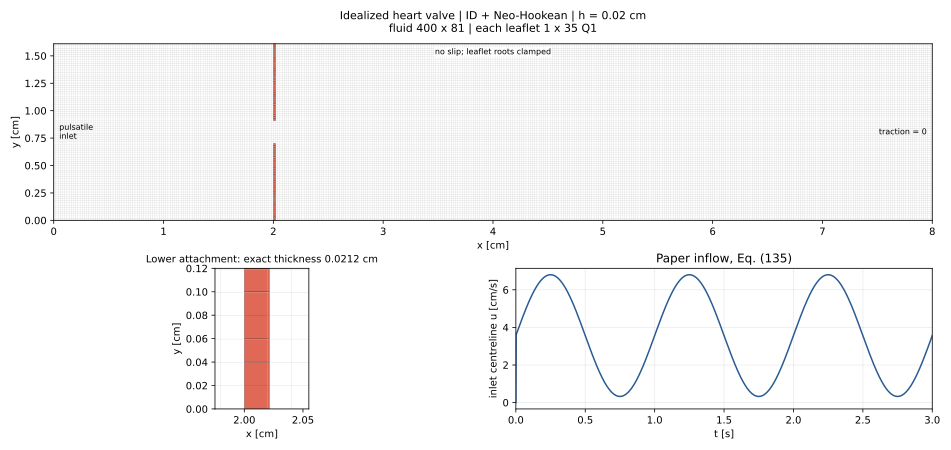

# Idealized heart valve: ID + Neo-Hookean

Source: R. T. Black and G. I. Park, *An immersed fluid–structure interaction
method targeted for heart valve applications*, CMAME 435 (2025), 117634,
[DOI](https://doi.org/10.1016/j.cma.2024.117634). The local PDF is
`related papers/1-s2.0-S0045782524008880-main.pdf`.
This setup uses section 4.3.1 (PDF pages 21–23), figure 12, and equations
(135)–(136), with this repository's ID coupling and MAC/Chorin fluid solver.



## Geometry, units and boundary conditions

All quantities use the paper's **CGS units**: cm, g, s, dyne. The high but equal
fluid/solid densities below are the benchmark values printed in the paper.

| Quantity | Value |
| --- | --- |
| Channel | `0 <= x <= 8`, `0 <= y <= 1.61` cm |
| Leaflet thickness | `0.0212` cm, `2 <= x <= 2.0212` |
| Lower leaflet | `0 <= y <= 0.70` cm |
| Upper leaflet | `0.91 <= y <= 1.61` cm |
| Initial gap | `0.21` cm |
| Fluid and solid density | `100` g/cm³ each |
| Fluid dynamic viscosity | `10` Poise = `10` g/(cm s) |
| Fluid kinematic viscosity | `0.1` cm²/s |
| Young's modulus | `5.6e7` dyne/cm² |
| Poisson ratio | `0.4` |
| Solid Lamé constants | `lambda = 8e7`, `mu = 2e7` dyne/cm² |

- **Inlet, x = 0:** `u = 5*(sin(2*pi*t) + 1.1)*y*(1.61-y)` cm/s for
  `t > 0`, and `v = 0`. The fluid is initially at rest. There is no extra
  startup ramp: equation (135) has a jump at time zero.
- **Walls, y = 0 and y = 1.61:** no slip, `u = v = 0`.
- **Outlet, x = 8:** zero total traction,
  `(-p*I + mu*(grad(v) + grad(v).T))*n = 0`.
- **Leaflet attachments:** both displacement components fixed only along the
  bottom edge of the lower leaflet and top edge of the upper leaflet. The
  remaining edges interact with the fluid through ID.
- **Body forces:** zero; no gravity. Contact is not modeled, as in this
  shortened-leaflet benchmark.

The Neo-Hookean energy is exactly the form of equation (136). The local 2D
law uses plane strain with `F33=1`; its in-plane energy and stress therefore
match the plane-strain restriction of that equation. No extra volumetric
penalty, damping, heterogeneous stiffening, or anisotropic fibers are added.
The latter extensions belong to sections 4.3.2–4.3.3 and are not this case.

## Initial mesh and time settings

The single `mesh.resolution: 0.02` cm controls both meshes. Counts are rounded
to the nearest integer (half cases upward), preserving exact physical sizes.

| Mesh | Elements | Actual reference spacings [cm] |
| --- | --- | --- |
| Fluid | `400 x 81 = 32400` MAC cells | `0.020000 x 0.019876543` |
| Each leaflet | `1 x 35` Q1 quads | `0.021200 x 0.020000` |
| Both leaflets | `70` quads, `144` nodes | Same nominal resolution as fluid |

This is an initial coarse solid mesh, with one element through the thickness;
it is different from the paper's `4 x 40` elements per leaflet and its fluid
refinement sequence. Mesh refinement is needed for a quantitative convergence
comparison. The small differences in actual edge lengths above preserve the
paper geometry while keeping the shared nominal resolution.

The configuration retains the paper's `dt = 1e-4` s and `T = 3` s
(`30000` steps). Histories are stored every 100 steps, plus the initial and
final states. `--steps` overrides the duration for short checks without editing
the YAML. Equal fluid/solid densities make the ID inertia correction
`(rho_s-rho_f)*M` zero; the fluid still carries the full inertia. Keep
`mass_model: buoyant` to avoid double counting it.

The Aitken starting factor is `0.02`, with a lower bound of `1e-6`. At least
two coupling iterations are required per step to include the prescribed new
inlet in the solid response, even when the initial multiplier is zero.

## Run and preview

From the FSI repository root:

```bash
# Geometry/material validation; no simulation.
python3 code/cases/run_case.py code/cases/configs/idealized_heart_valve_id_neo_hookean.yaml --dry-run

# Export the setup figure; no simulation.
python3 code/cases/run_case.py code/cases/configs/idealized_heart_valve_id_neo_hookean.yaml --dry-run --preview docs/idealized_heart_valve_setup.svg

# Short startup check: 0.002 seconds.
python3 code/cases/run_case.py code/cases/configs/idealized_heart_valve_id_neo_hookean.yaml --steps 20

# Full configured duration: 3 seconds.
python3 code/cases/run_case.py code/cases/configs/idealized_heart_valve_id_neo_hookean.yaml
```

Results are written below
`code/cases/outputs/idealized_heart_valve_id_neo_hookean/`. The existing
`code/plots/visualization.ipynb` can load the result by setting
`SIMULATIONS = ["idealized_heart_valve_id_neo_hookean"]`.
The NPZ includes kinematic `p_f` and physical `p_f_physical = rho_f*p_f`.
The CSV records geometry, actual spacings, material, units, and BCs. It also
records the actual `Nt`, `dt`, history stride, and upper/lower tip node IDs,
whose displacements can be averaged to track
the midpoint of each free edge.
The NPZ `frame_indices` retains the actual saved time steps even for a short
`--steps` run ending between history-stride intervals.

## Traction-free outlet in the MAC solver

This case uses `fluid_assembly_traction_free` with
`fluid_solver_CF(..., traction_free=True)`. The standard channel behavior is
the default for other cases. A sinusoidal inlet is evaluated once per physical
time step through the new optional `inlet_velocity_fn(time)` callback.

Write `pi = p/rho` for the kinematic pressure, and let `u_e` be the normal
velocity at the east boundary, `u_i` the adjacent interior normal velocity,
and `pi_b` the interpolated boundary pressure. The discrete normal traction is

```text
pi_b = 2*nu*(u_e-u_i)/dx
u_e = u_e_star - (2*dt/dx)*(pi_b-pi_last)
q = 4*nu*dt/dx^2
u_e = (u_e_star + q*u_i + (2*dt/dx)*pi_last)/(1+q)
```

The outlet predictor advances its own previous-time velocity:

```text
u_e_star = u_e_old + dt*(2*R_i_old - R_{i-1}_old + f_e_old/rho)
```

Here `R` contains the interior convective/diffusive acceleration. Only this
momentum RHS is extrapolated to the boundary; the force is evaluated on the
outlet face itself. This preserves the outlet velocity's time history.
Eliminating `u_e` in the last pressure-cell
divergence equation gives the east pressure row its x-direction diagonal
`-3*(dy/dx)/(1+q)` and west coefficient `(dy/dx)/(1+q)`. The predictor's outlet
flux is modified consistently before forming the pressure RHS. The tangential
velocity ghost value enforces `dv/dx = -du/dy`. Thus both total traction
components and the projection's divergence constraint are enforced together,
rather than replacing total traction by `p=0`. The normal derivative closure
is first order at the outlet. No-slip takes precedence at the wall/outlet
corners.

## Verification performed

`python3 -m unittest discover -s code/tests -v` passes 17 tests, covering the
material tangents and rigid-motion invariance, geometry and root constraints,
equation (135), pressure projection, outlet traction, flow balance, and short
ID runs. The existing channel solver is also compared with its debug reference.

The original outflow implementation replaced the normal-velocity predictor by
`2*u_i_star - u_{i-1}_star` at every step. In a divergence-free manufactured
field this caused a finite change in outlet velocity even as `dt` approached
zero. The new regression checks that the velocity increment instead decreases
in proportion to `dt`. This correction preserves **zero total traction** and
adds no backflow traction, velocity clipping, material damping, or change of
physical geometry/parameters.

A standalone fluid run on the actual `400 x 81` mesh completed **30000 steps /
3 seconds** at `dt=1e-4` with bounded velocities, including the deceleration and
local backflow phases. The former predictor diverged at approximately
`0.6383` s in the same fluid-only configuration.

The coupled ID case completed **10000 steps / 1 second** on the same mesh,
with the same material, inlet, and `dt=1e-4`. Its minimum saved deformation
Jacobian was `0.951698` and maximum saved fluid speed
was `11.7820` cm/s. At `t=0.6` s the maximum speed
was `6.3735` cm/s, versus `51.3743` cm/s with the former outlet
predictor. The roots remained fixed, final maximum discrete divergence was
`1.7e-12` 1/s, and both outlet traction residuals
were below `1e-10` dyne/cm².

The user subsequently completed the corrected **30000-step / three-second
coupled run**, saved as
`code/cases/outputs/idealized_heart_valve_id_neo_hookean/idealized_heart_valve_id_neo_hookean.npz`.
Its metadata records the corrected outlet predictor and 301 saved states at
0.01 s intervals. The tip-displacement comparison below uses that full run;
the Jacobian and traction measurements above refer to the earlier one-cycle
verification.

The earlier movie/result files with suffix `_6000` show the former predictor
and its instability. Corrected one-cycle results use suffix `_outlet_corrected`.

This validates the implementation against these checks, not quantitative
agreement with the paper's leaflet histories. The paper uses a monolithic
VMS/generalized-alpha discretization; this setup uses the repository's
ID/MAC/Chorin/Newmark scheme as requested.


## Tip displacement versus ALE (Fig. 14)

From the FSI repository root, regenerate the two plots with:

```bash
python3 code/plots/compare_heart_valve_tip.py
```

The default result is the full three-second run named above. To select another
ID + Neo-Hookean result, pass its NPZ path as the positional argument. The script
loads only `P`, `u_s` and `frame_indices`; the fluid history is not needed.
It plots the entire 0–3 s interval, with the same axes and units as Fig. 14.
The x/y limits are respectively 0–0.6 cm and 0–0.5 cm.

Figures are saved under `code/plots/figures/heart_valve_tip_comparison/`:

- `heart_valve_tip_x_comparison.{png,pdf,svg}`: horizontal displacement.
- `heart_valve_tip_y_comparison.{png,pdf,svg}`: vertical displacement.
- `heart_valve_tip_comparison.{png,pdf,svg}`: both panels side by side.
- `heart_valve_tip_id.csv`: midpoint and left/right endpoint histories.
- `heart_valve_tip_comparison.csv`: ID data and linearly interpolated ALE data
  at the saved physical times. NaN denotes times outside the extracted curve;
  no extrapolation is performed.
- `heart_valve_tip_comparison.json`: tip definition, mesh, time range and
  comparison statistics. RMSE uses only saved times within reference coverage;
  last-cycle maxima use the samples of each curve in 2–3 s.

### Reference provenance

The source is Black & Park, *An immersed fluid–structure interaction method
targeted for heart valve applications*, CMAME 435 (2025) 117634,
[DOI 10.1016/j.cma.2024.117634](https://doi.org/10.1016/j.cma.2024.117634),
Fig. 14, PDF page 24. The black dashed curves are labeled
“ALE - Kamensky et al.” and refer to reference [26]: Kamensky et al.,
*An immersogeometric variational framework for fluid–structure interaction:
Application to bioprosthetic heart valves*, CMAME 284 (2015) 1005–1053,
[DOI 10.1016/j.cma.2014.10.040](https://doi.org/10.1016/j.cma.2014.10.040).

`code/cases/reference_data/idealized_heart_valve_ale_fig14.csv` stores 99 x-curve
points and 115 y-curve points in long form (`component,time_s,displacement_cm`).
They are **published graphical data, not the original ALE solver output**.
The extraction reads the complete black dashed vector centerlines after
converting page 24 to SVG with Poppler's `pdftocairo`. Linear calibration uses
the actual plot borders and printed axis limits. Thus overlaps with the colored
curves and gaps in the dashed strokes do not require guessing missing values.
No smoothing, fitted waveform, phase shift or amplitude rescaling is applied.
The accompanying JSON records the PDF SHA-256, calibrated bounds and provenance.
The decimal precision in the CSV preserves the extraction, not the accuracy of
unavailable original ALE data. To repeat the extraction and plotting:

```bash
python3 code/plots/compare_heart_valve_tip.py \
  --extract-ale "related papers/1-s2.0-S0045782524008880-main.pdf"
```

### Tip definition and interpretation

For ID, the observable is the displacement of the **material midpoint of the
upper leaflet's free edge**, initially at `(2.0106, 0.91)` cm. For the current
one-element-thick Q1 mesh, it is the mean of the two tip-node displacements
(nodes 72 and 108, zero-based), evaluated from the blocked `u_s` history. It is
displacement from the undeformed geometry, including in the later cycles.
With a refined mesh the script evaluates the piecewise-linear free edge at
that same reference midpoint. Fig. 14 does not specify a particular corner
across the thickness; the endpoint histories are exported to make this choice
explicit. Across the saved run, the two endpoint y-displacements differ by up
to 0.0196 cm.

For the saved full run, the last-cycle peak values are:

| Component | ID + Neo-Hookean (cm) | ALE from Fig. 14 (cm) | Peak difference |
| --- | ---: | ---: | ---: |
| x | 0.5304 | 0.5834 | −9.1% |
| y | 0.2955 | 0.4100 | −27.9% |

These compare different discretizations and constitutive models. Section 4.3.1
states that the ALE reference uses **Saint Venant–Kirchhoff and quadratic
B-splines**, whereas this run uses **Neo-Hookean, Q1 solid elements and ID**.
The current solid has 1×35 elements per leaflet, versus 4×40 in Black & Park;
their fluid curves use different meshes as well. These differences prevent
attributing the observed amplitude discrepancy to the coupling method alone.
